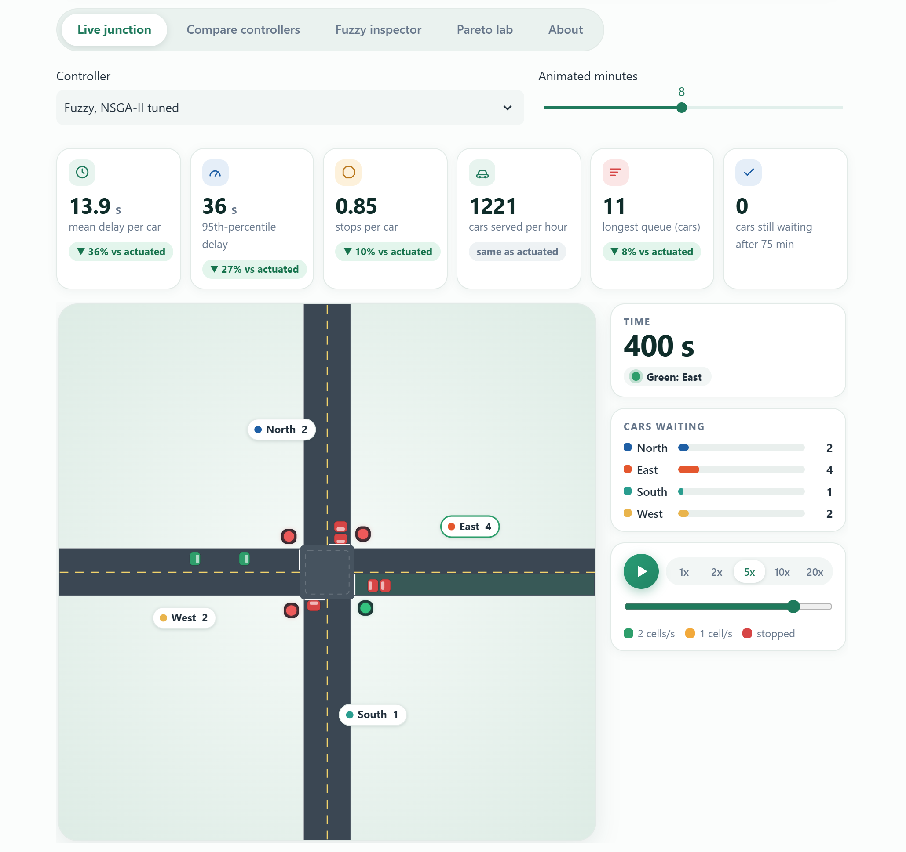

# GreenPulse: a fuzzy traffic signal tuned by NSGA-II

**Live demo:** LIVE_URL_PLACEHOLDER



A four-way junction is simulated car by car (Nagel-Schreckenberg cellular automaton). Two Mamdani fuzzy systems
decide which approach gets the next green and how long that green may last. The 20 numbers that define the fuzzy
sets and the timing limits are found by NSGA-II, a multi-objective genetic algorithm that trades off mean delay,
95th-percentile delay and stops per car. Everything is written from scratch in Python; all traffic is simulated.

A Soft Computing mini project by Sahil Yadav, B.Tech CSE (Data Science), Amity School of Engineering and Technology, Noida.

## The web application

Five tabs. **Live junction**: an animated junction with six key numbers that show how the chosen controller compares with
the vehicle-actuated one, and two charts (cars waiting, who has green). **Compare controllers**: every controller on the
same traffic, ranked. **Fuzzy inspector**: set a queue, a waiting time and a pressure and see the urgency, the green time
and the rules that fire as bars, for any of the five fuzzy controllers. **Pareto lab**: slide along the NSGA-II front and
use any member as the controller. **About**. The demand pattern (including an unseen random mix and your own flows), a
demand multiplier, the random seed ("New random traffic" draws a new one), rain, sensor noise and missed detections are
set in the sidebar.

The demo is hosted on Streamlit Community Cloud and is rebuilt on every push to `main`. A free app goes to sleep when
nobody has opened it for a while; the first visit wakes it up, which takes up to a minute.

## Headline results (120 held-out runs, negative = better)

| Comparison | Mean delay | 95th-percentile delay | Stops |
|---|---|---|---|
| NSGA-II controller (greens from 4 s) vs best fixed plan | -51% | -37% | -30% |
| NSGA-II controller (greens from 4 s) vs vehicle-actuated | -37% | -26% | -10% |
| Practical controller (greens >= 8 s, tuned on clean traffic) vs vehicle-actuated | -14% | +10% | -10% |
| Practical controller (greens >= 8 s, tuned on stressed traffic) vs vehicle-actuated | -4% | +6% | -5% |

Under noisy sensors, rain and 20% more demand together, the controller tuned on clean traffic needs 103.7 s per car
against 45.2 s for the actuated controller; the controllers tuned on stressed traffic stay near 36-37 s.
Part of the headline gain comes from greens as short as 4 s, which a model without pedestrians does not punish; the
realistic numbers are the ones with greens of 8 s or more.

This is a result about a model (one lane per approach, no turns, no pedestrians, random arrivals). It says how
controllers rank, not how many seconds a real junction would save.

## What is in the repository

| Folder | Content |
|---|---|
| `src/greenpulse/` | simulator (`sim.py`), fuzzy systems (`fuzzy.py`), baselines, Webster formulas, scenarios, GA / NSGA-II / random search (`ga.py`) |
| `experiments/` | numbered scripts: validation, tuning, evaluation, figures, app screenshots |
| `app/` | Streamlit web application (`app.py`), its stylesheet (`style.css`) and the HTML canvas animation (`anim.html`) |
| `tests/` | 12 unit tests of the model and the search, and 8 tests that run the whole web application (`test_app.py`) |
| `results/` | every number behind the results above (JSON), including all tuned controllers |
| `data/` | the data of the project as CSV and one NumPy file: the 140 generated traffic streams, all 1,320 test runs, stress tests, Pareto fronts, tuned parameters, simulator checks (there is no external data set, the junction is simulated; see `data/README.md`) |
| `figures/` | figures of the results and screenshots of the application |
| `SECURITY_REVIEW.md` | what was checked for vulnerabilities and errors, what was found and fixed |

## Run it on your computer

```bash
pip install -r requirements.txt
python tests/test_traffic.py          # 12 unit tests, about 20 s the first time (Numba compiles)
python tests/test_app.py              # 8 tests that run the web application with extreme settings, about a minute
streamlit run app/app.py              # the web application (run it from this folder)
```

Start the application from this folder: `.streamlit/config.toml` then makes it listen on this computer only
(`127.0.0.1`), keeps the browser protections on and switches off usage statistics. `requirements.txt` asks for a
Streamlit version without known security advisories (1.54 or newer); the app also runs on 1.33.

## Reproduce every number

The ready-made results are in `results/`, so this is only needed to repeat the experiments. Run from this folder, in order:

```bash
python experiments/10_validate_sim.py                    # saturation flow, fundamental diagram, Webster check
python experiments/11_tune.py 80 80                      # NSGA-II, GA, random search, 5 runs each (about 13 min)
python experiments/13_robust_tune.py 80 80 3             # tuned on stressed traffic
python experiments/15_practical_tune.py 80 80 3          # stressed traffic and minimum green >= 8 s
python experiments/16_practical_clean_tune.py 80 80 3    # clean traffic and minimum green >= 8 s
python experiments/12_evaluate.py                        # held-out evaluation of every controller
python experiments/17_practical_front.py                 # the two realistic-green Pareto fronts on the test seeds
python experiments/13_make_figures.py                    # all figures
python experiments/18_export_data.py                     # the CSV files in data/
```

Tuning uses the seeds 101-105 and four demand patterns; every comparison uses the seeds 1001-1020 and six patterns, two of
which (East-West rush, random mix) are never used in tuning. Tuning needs a multi-core machine; it spawns worker processes.
